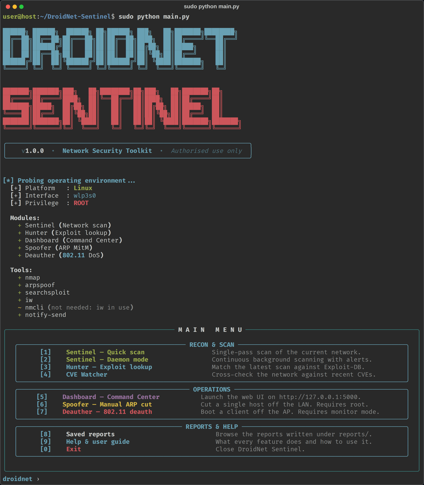
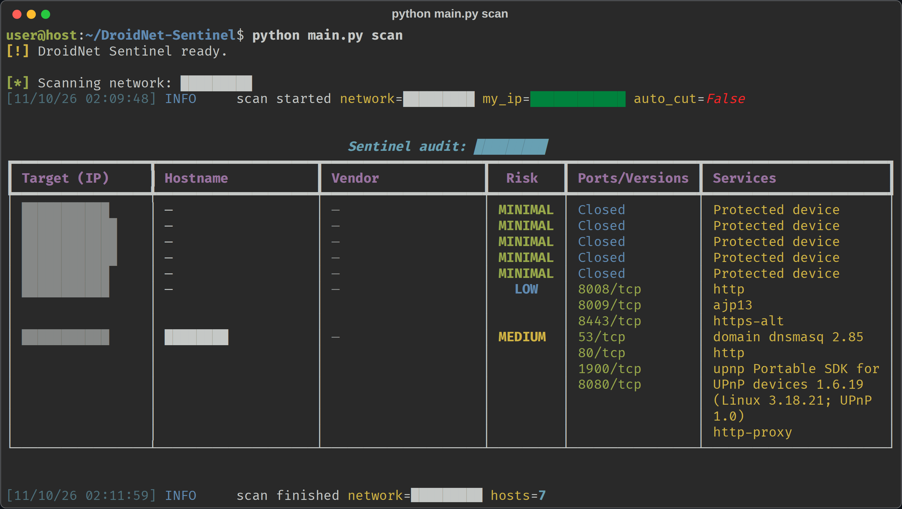
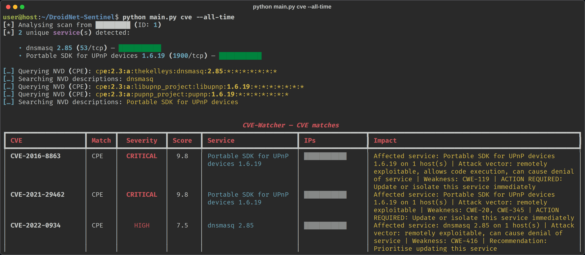
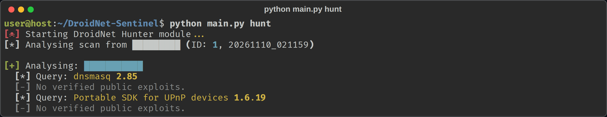
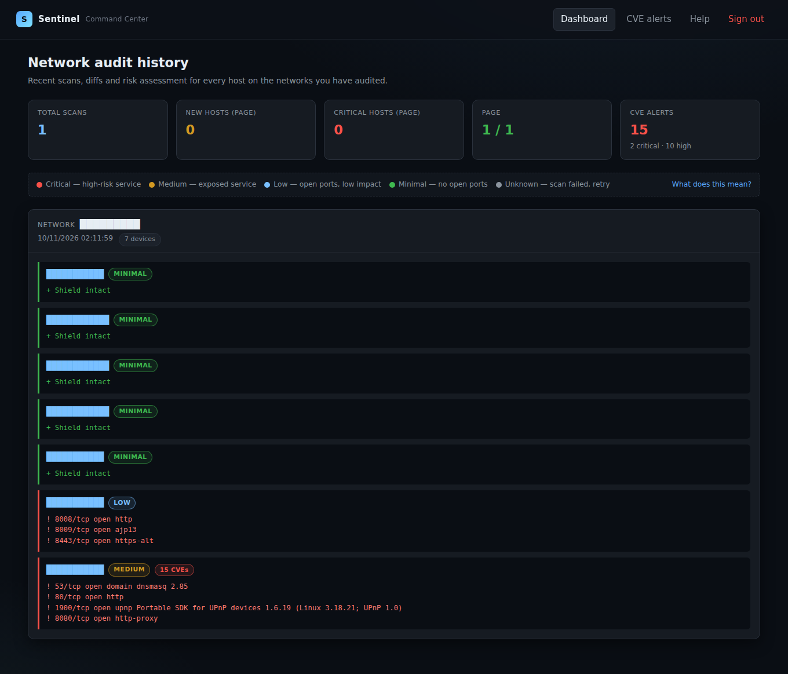
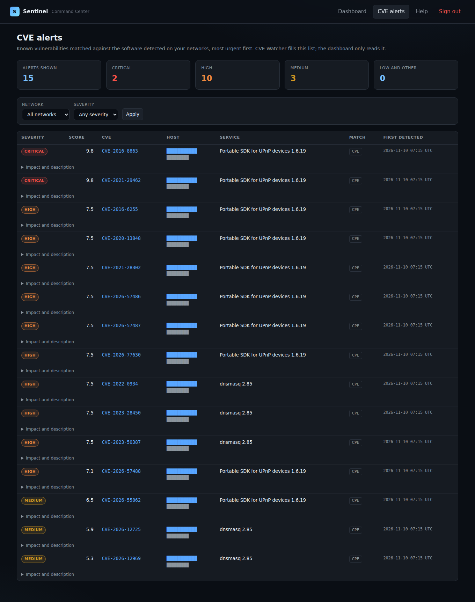
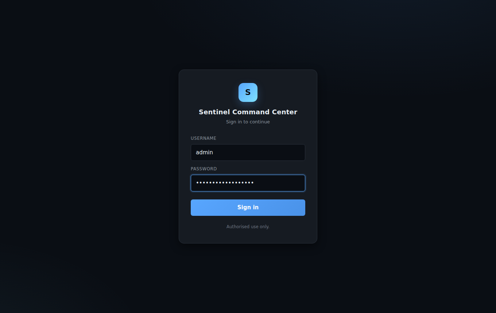
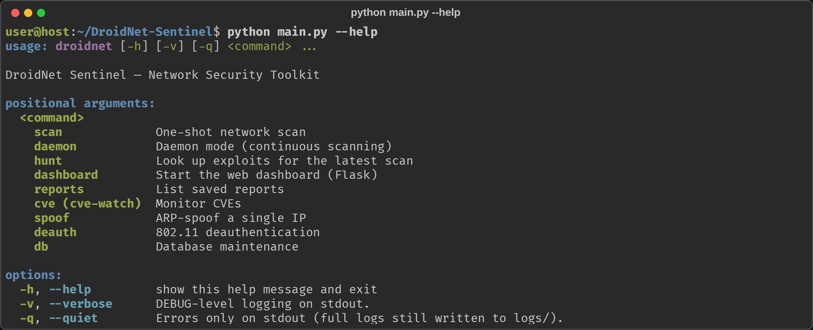

# DroidNet Sentinel

[](LICENSE)


[](https://github.com/kahz12/DroidNet-Sentinel/actions/workflows/ci.yml)

Wi-Fi network auditor for Android (Termux) and Linux. From one command-line
tool it discovers live hosts, fingerprints their services, classifies each
host by risk, cross-references the detected software against public exploits
and CVEs, and tracks how the network changes between scans. An authenticated
web dashboard shows the history and the differences between scans.

**Full documentation:** [English guide](docs/user-guide.en.md) ·
[Guía en español](docs/user-guide.es.md)

---

## Authorized use only

Port scanning, ARP cutting and 802.11 deauthentication can disrupt a network
and are illegal in most jurisdictions without permission. Use this tool only
on networks you own or are explicitly authorized to test. Scanning,
Hunter, CVE Watcher and the dashboard only read; the Spoofer, the Deauther
and `scan --auto-cut` interfere with other devices and must never be aimed at
a network you are not authorized to disrupt.

---

## Features

- **Discovery and scanning.** Ping-sweep of the local `/24`, then a two-pass
  per-host scan: top 100 TCP ports, then version detection on the open ones.
- **Device identification.** Names and models from the router's DNS, mDNS,
  UPnP and Google Cast, without root; randomized (private) MACs are flagged
  as such. With root, passive DHCP fingerprints (options 12, 55 and 60) add
  the operating system, even behind a randomized MAC.
- **Risk engine.** Per-host classification (CRITICAL / MEDIUM / LOW / MINIMAL
  / UNKNOWN) from a single shared rule.
- **Diff history.** New hosts, disappeared hosts and port changes between
  consecutive scans.
- **Exploit lookup.** Exploit-DB search via `searchsploit`, the Vulners API
  (with a key) or the Exploit-DB catalogue, downloaded once and searched offline.
- **CVE Watcher.** NVD cross-reference by CPE and by description, in a 120-day
  watch mode or a full audit of any date.
- **Active response.** Manual or automatic ARP cut; 802.11 deauthentication.
- **Guardian mode.** `daemon --auto-cut` continuously cuts anything not in
  your allowlist, with an audit journal, graceful ARP restore on SIGTERM/SIGHUP
  and a documented boot autostart; it refuses to run with an empty allowlist.
- **Web dashboard.** Authenticated Flask UI with scan history, diffs, a CVE
  alerts view filterable by network, host and severity, and an in-app guide.
- **Alerting.** Desktop/Termux notifications and Telegram.
- **Cross-platform.** One codebase on Android (Termux) and Linux.

---

## Screenshots

Captured during a real audit. The network name, IP addresses and host names
are redacted.

<table>
  <tr>
    <td width="50%"><br><sub>Interactive menu and environment probe, run as root: every module available (only the Spoofer and the Deauther need root)</sub></td>
    <td width="50%"><br><sub>Scan: risk, open ports and versions per host</sub></td>
  </tr>
  <tr>
    <td><br><sub>CVE Watcher: detected services matched against the NVD</sub></td>
    <td><br><sub>Hunter: Exploit-DB lookup per service</sub></td>
  </tr>
  <tr>
    <td><br><sub>Dashboard: scan history and risk per host</sub></td>
    <td><br><sub>CVE alerts, filterable by network, host and severity</sub></td>
  </tr>
  <tr>
    <td><br><sub>Dashboard sign-in</sub></td>
    <td><br><sub>Command-line help</sub></td>
  </tr>
</table>

---

## Install

### Linux (Debian, Ubuntu, Kali)

```bash
sudo apt install python3 python3-pip python3-venv nmap dsniff libnotify-bin iw
git clone https://github.com/kahz12/DroidNet-Sentinel.git
cd DroidNet-Sentinel
python3 -m venv venv && source venv/bin/activate
pip install -r requirements.txt
python main.py
```

### Android (Termux)

```bash
pkg install python nmap termux-api
git clone https://github.com/kahz12/DroidNet-Sentinel.git
cd DroidNet-Sentinel
python -m venv venv && source venv/bin/activate
pip install -r requirements.txt
python main.py
```

`nmap` is required for all scanning; everything else is optional and only
needed by a specific module. See
[Optional tools](docs/user-guide.en.md#6-optional-tools) for the full list.

---

## Usage

Run `python main.py` with no arguments for the interactive menu, or use the
non-interactive subcommands:

```bash
python main.py scan [--auto-cut]           # one-shot scan
python main.py daemon [--auto-cut]         # continuous scan
python main.py hunt                        # exploit lookup
python main.py cve [--all-time]            # CVE Watcher (120-day watch, or full audit)
python main.py dashboard [--expose]        # web UI (loopback by default)
python main.py reports                     # list saved reports
python main.py spoof VICTIM GATEWAY        # ARP cut (root)
python main.py deauth MAC BSSID --iface IF # 802.11 deauth (root)
python main.py db purge [--days N]         # prune old scans
```

Add `--help` to any subcommand for its full flag set. The complete reference
is in the [user guide](docs/user-guide.en.md#8-command-line-reference).

---

## Configuration

Optional `config.json` at the project root:

```json
{
    "excluded_ips":      ["192.168.1.100"],
    "trusted_ips":       ["192.168.1.1", "192.168.1.50"],
    "db_retention_days": 90
}
```

Key environment variables: `SENTINEL_USER` / `SENTINEL_PASS` (dashboard
login), `TELEGRAM_TOKEN` / `TELEGRAM_CHAT_ID` (alerts), `NVD_API_KEY` (higher
CVE rate limit), `VULNERS_API_KEY` (Hunter source without `searchsploit`).
They can also be kept in a `.env` file at the project root, one `NAME=value`
per line; the file is ignored by git. Full configuration reference:
[user guide](docs/user-guide.en.md#9-configuration).

---

## Risk levels

| Level    | Triggered by                                                   |
|----------|----------------------------------------------------------------|
| CRITICAL | FTP (21), Telnet (23), NetBIOS (139), SMB (445), RDP (3389)    |
| MEDIUM   | HTTP (80, 8080), DNS (53), SSDP (1900), NFS (2049), MQTT, CoAP |
| LOW      | Any other open port                                            |
| MINIMAL  | No open ports (all closed or filtered)                         |
| UNKNOWN  | Failed, unreachable or inconclusive scan                       |

---

## Data and layout

```
main.py
  cli/        argument parsing and the interactive menu
  core/       database, env probe, notifier, risk engine
  modules/    sentinel, hunter, cve_watcher, spoofer, deauther
  platform/   cross-platform helpers (Android / Linux)
  web/        Flask dashboard and /help guide
```

Scan results are stored in `sentinel.db` (SQLite) and mirrored as timestamped
JSON under `reports/`. NVD responses are cached in `nvd_cache/` and Hunter's
Exploit-DB catalogue in `exploitdb_cache/`; logs go to `logs/droidnet.log`.

---

## Security notes

- The dashboard binds to `127.0.0.1` by default. Use `--expose` only behind a
  TLS proxy; credentials travel in clear text over plain HTTP.
- Login is rate-limited (5 attempts per minute per IP) with per-session CSRF
  and a constant-time credential check.
- Auto-generated dashboard passwords are written to `~/.sentinel/credentials`
  (mode 0600), never printed.
- All `subprocess` calls take list arguments (no `shell=True`), TLS
  verification is never disabled, and SSIDs are sanitized before becoming
  file paths. These invariants are enforced by tests in
  `tests/test_security_invariants.py`.

---

## Development

```bash
pip install -r requirements-dev.txt
python -m pytest -q
python -m ruff check droidnet main.py tests --select F,E9,B
python -m vulture droidnet main.py --min-confidence 80
```

The suite simulates scanning, packet transmission, interface changes and
external API requests; it never touches the real network, database or log.
GitHub Actions runs these checks on every push to `main` and every pull
request, with the tests on Python 3.10 through 3.14
([`.github/workflows/ci.yml`](.github/workflows/ci.yml)).

---

## License

Released under the [MIT License](LICENSE).
